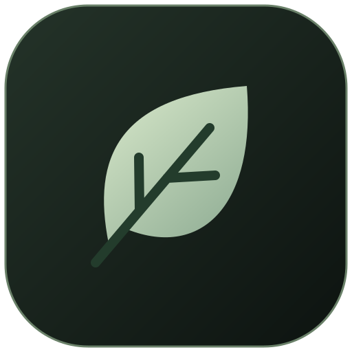

<p align="center"></p>

<h1 align="center">Nolithium</h1>

<p align="center">A quiet glass desk for notes on Windows.</p>

> **Public beta.** Nolithium is in beta (0.x). It saves carefully, but it is still young: keep a copy of anything important (see [Your notes](#your-notes)) and please [report problems](https://github.com/MuratBicici/Nolithium/issues/new/choose).

Notes live as square glass tiles on a desk. Click one and it opens into a calm, full-window editor; close it and it settles back into place. Nothing else competes for your attention: no toolbars, no sidebars, no account.

## Features

- **Writing without symbols.** Headings, bold, italic, highlight, links, lists, clickable checklists, quotes and code blocks appear as formatting. Select text for a small style bubble, or type `/` for blocks. Markdown shortcuts (`# `, `- `, `[] `…) still work if you know them.
- **Open with Nolithium.** Right-click a `.md`, `.txt` or any other text file → *Open with* → Nolithium. It opens as a note linked to the file; your edits are saved back to the file, in its original encoding and line endings.
- **Your desk, your look.** Pick a glass colour (or mix your own) and how frosted it is; pin, rename and mark notes with a symbol.
- **Safe by default.** Everything saves as you type, closing waits for pending saves, and a file changed by another program is never overwritten without asking.
- **Updates that ask first.** When a new version is out, Nolithium offers it; nothing is downloaded until you agree.

## Install

1. Download `Nolithium_<version>_x64-setup.exe` from the [latest release](https://github.com/MuratBicici/Nolithium/releases/latest).
2. Run it. It installs for your account only and needs no administrator rights.
3. Windows may show **"Windows protected your PC"**, because the installer isn't code-signed yet. Choose **More info → Run anyway**.

Requires Windows 10 or 11 (64-bit). The WebView2 runtime is built into Windows 11 and installed automatically on Windows 10 if missing.

## Getting around

| | |
|---|---|
| New note | Click an empty slot, or **Ctrl+N** |
| Open / close a note | Click it / **Esc** or click outside |
| Rename, symbol, pin, remove | Right-click a tile |
| Style selected text | Select it, then use the bubble (or **Ctrl+B**, **Ctrl+I**, **Ctrl+K** for a link) |
| Insert a heading, list, checklist… | Type `/` |
| Tick a checklist item | Click its box, or **Ctrl+Enter** |
| See the raw Markdown | **Ctrl+Shift+M** |
| Follow a link | **Ctrl+click** |
| Glass colour, blur, version, updates | The palette button at the top right |

## Your notes

Notes are stored on your computer only, as Markdown, in:

```
%APPDATA%\com.nolithium.desktop\desk.json
```

The previous version is kept beside it as `desk.json.bak`. To back up your desk, copy that folder somewhere safe. Notes opened from files (*Open with*) are saved in those files; removing such a note from the desk never deletes the file.

## Feedback

Found a bug or have an idea? [Open an issue](https://github.com/MuratBicici/Nolithium/issues/new/choose). The version number is shown in the palette panel. Please don't paste private notes into issues.

## Building from source

See [docs/DEVELOPMENT.md](docs/DEVELOPMENT.md).

## License

[MIT](LICENSE) © 2026 Murat Emre Biçici
